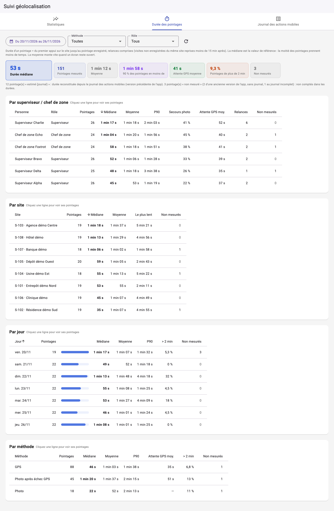
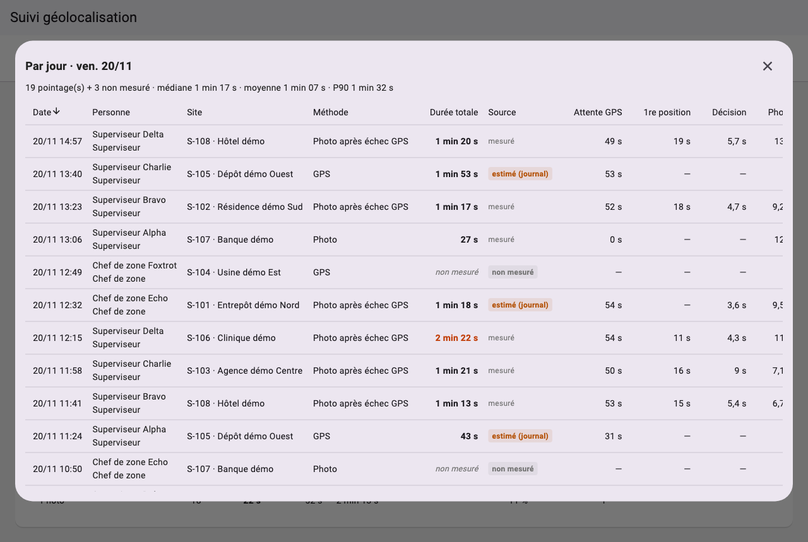

# Pointage géo avec photo de secours — côté web

Back-office du contrat de données partagé avec l'app mobile (spasmobile).
Rien n'est déployé : ni hébergement, ni index, ni règles.

## Écrans

| Écran | Où | Ce qui est écrit dans Firestore |
|---|---|---|
| Configuration Mobile → « Pointage par géolocalisation » | `lib/mobile_config/geo_pointing_settings_panel.dart` | Après confirmation, uniquement `geoPointing.photoOfferAfterSeconds`, `photoFallbackEnabled`, `accuracyRule`, `updatedAt`, `updatedBy` (`set` avec un masque de champs `mergeFields: [FieldPath(['geoPointing', …])]`). Les autres champs du document et les autres sous-champs de `geoPointing` ne sont ni modifiés ni supprimés. |
| Fiche superviseur / chef de zone → « Mode de pointage » | `lib/supervisor/supervisor_form.dart`, `lib/zone_member/zone_member_form_modern.dart` | `pointageModeOverride` = `photo` / `geo`, ou champ supprimé pour « Selon le pays ». Seul le formulaire écrit ce champ. |
| Tableaux de pointage | colonne « Méthode » | lecture seule |
| Erreurs de pointage | nouveaux filtres, cartes du détail, « Parcours de la visite » | lecture seule (la résolution existante ne change pas) |
| Suivi géolocalisation (onglets Statistiques, Durée des pointages, Journal des actions mobiles) | menu Pointages, route `/suivi-geolocalisation` | lecture seule |

### Réglages géo (bornes)

| Champ | Bornes | Recommandé |
|---|---|---|
| `photoOfferAfterSeconds` (« Bouton photo après (secondes) ») | 15–120 s (pas de 5 s) | 45 |
| `photoFallbackEnabled` | Oui / Non | Oui |
| `accuracyRule` | `normal` / `strict` | `normal` |

Le téléphone fait une seule recherche GPS continue par visite (180 s au plus)
et propose le bouton photo après `photoOfferAfterSeconds` pendant que la
recherche continue.

Une valeur hors bornes lue dans Firestore est ramenée dans les bornes ; un
document ou un champ absent affiche les valeurs recommandées.

Anciens champs `attemptTimeoutSeconds` / `attemptsBeforePhoto` : toujours lus
par les téléphones en version 1.8.0+18. Le web les affiche s'ils existent mais
ne les écrit jamais : un enregistrement ne les modifie ni ne les supprime
(testé dans `test/services/geo_pointing_config_test.dart`). La modification
est réservée aux profils qui peuvent déjà couper le suivi continu
(Administrateur / Directeur Général avec le droit « ajouter » sur Config
Mobile), car le réglage s'applique à tous les pays.

### Taux de secours photo

`photo_fallback ÷ (geo + photo_fallback)` sur la période. Les pointages faits
en mode Photo ne comptent pas. Anciens pointages sans `pointingMethod` :
`geoMetadata` sans photo = Géo, photo = Photo, sinon « inconnu » (affiché « — »).

### Durée des pointages

Onglet « Durée des pointages » de « Suivi géolocalisation »
(`lib/geo_tracking/pointing_duration_tab.dart`) : durée médiane (valeur de
référence), moyenne, P90, part au-delà de 2 min et attente GPS moyenne, au
global, par superviseur / chef de zone, par site, par jour et par méthode
(GPS / Photo après échec GPS / Photo). Filtres méthode et rôle ; un clic sur
une ligne ouvre ses pointages avec le détail (attente GPS, 1re position,
décision, photo, enregistrement, relances).

Durée = du premier appui sur le site jusqu'au pointage enregistré, relances
comprises. Source, affichée sur chaque pointage :

- **mesuré** : carte `pointingDuration` écrite par le téléphone (`totalMs`,
  `gpsWaitMs`, `firstFixMs`, `decisionMs`, `photoMs`, `saveMs`, `relaunches`,
  `startedAt`), horloge monotone : valable même si l'heure du téléphone est
  fausse ;
- **estimé (journal)** : pointage sans `pointingDuration` mais avec
  `visitId` ; durée reconstituée depuis `mobile_events` (`pointing_started` →
  `pointing_saved`, visites non enregistrées du même site reprises moins de
  15 min après) ;
- **non mesuré** : ni l'un ni l'autre (ancienne version de l'app sans
  journal, ou journal incomplet), ou `totalMs` à 0. Ces pointages sont listés
  et comptés à part (colonne « Non mesurés »), jamais affichés « 0 s » ni pris
  dans les statistiques.

Lecture : `sitePointings` et `zonePointings` sur la période (index
existants), puis `mobile_events` par `visitId` (égalités, sans index) et
`pointing_started` des mêmes personnes (`userId` + `event` + `timestamp` :
index de la table ci-dessous).





Aperçus régénérés avec `flutter test tool/preview_pointing_durations_test.dart`
(données fictives de `test/geo_tracking/duration_fixtures.dart`).

## À faire par le propriétaire

### 1. Règles Firestore

La collection `mobile_events` est nouvelle : les managers du back-office
doivent pouvoir la **lire** (avec le même filtre pays que les autres
collections). Sans cette règle, le journal affiche une erreur et le parcours
de la visite affiche « Non chargé — mobile_events : permission-denied » mais
montre le reste.

### 2. Index composites (Firestore les demande au premier usage)

Les requêtes de « Parcours de la visite » n'utilisent que des égalités
(`visitId` + filtres pays/département) : aucun index composite.
Les statistiques réutilisent les plages de dates déjà utilisées par les écrans
de pointage et d'erreurs.

Nouveaux index nécessaires (ajouter `tenantId ASC` en premier champ pour les
profils limités à un pays, et `departmentId ASC` pour les profils limités à
un département) :

| Collection | Champs | Utilisé par |
|---|---|---|
| `error_logs` | `attemptOutcome ASC`, `timestamp DESC` | filtre « Résultat de l'essai GPS » |
| `error_logs` | `appVersion ASC`, `timestamp DESC` | filtre « Version de l'app » |
| `error_logs` | `deviceInfo.model ASC`, `timestamp DESC` | filtre « Modèle de téléphone » |
| `mobile_events` | `tenantId ASC`, `timestamp DESC` | journal (profil limité à un pays) |
| `mobile_events` | `userId ASC`, `timestamp DESC` | journal filtré par personne |
| `mobile_events` | `event ASC`, `timestamp DESC` | journal filtré par action |
| `mobile_events` | `userId ASC`, `event ASC`, `timestamp DESC` | journal filtré par personne et action ; durées estimées (`pointing_started`) |

Combinés aux filtres existants (statut, type d'erreur…), Firestore peut
demander d'autres combinaisons : le message d'erreur contient le lien de
création de l'index exact. Extrait pour `firestore.indexes.json` :

```json
{
  "indexes": [
    {"collectionGroup": "error_logs", "queryScope": "COLLECTION", "fields": [
      {"fieldPath": "attemptOutcome", "order": "ASCENDING"},
      {"fieldPath": "timestamp", "order": "DESCENDING"}]},
    {"collectionGroup": "error_logs", "queryScope": "COLLECTION", "fields": [
      {"fieldPath": "appVersion", "order": "ASCENDING"},
      {"fieldPath": "timestamp", "order": "DESCENDING"}]},
    {"collectionGroup": "error_logs", "queryScope": "COLLECTION", "fields": [
      {"fieldPath": "deviceInfo.model", "order": "ASCENDING"},
      {"fieldPath": "timestamp", "order": "DESCENDING"}]},
    {"collectionGroup": "mobile_events", "queryScope": "COLLECTION", "fields": [
      {"fieldPath": "tenantId", "order": "ASCENDING"},
      {"fieldPath": "timestamp", "order": "DESCENDING"}]},
    {"collectionGroup": "mobile_events", "queryScope": "COLLECTION", "fields": [
      {"fieldPath": "userId", "order": "ASCENDING"},
      {"fieldPath": "timestamp", "order": "DESCENDING"}]},
    {"collectionGroup": "mobile_events", "queryScope": "COLLECTION", "fields": [
      {"fieldPath": "event", "order": "ASCENDING"},
      {"fieldPath": "timestamp", "order": "DESCENDING"}]},
    {"collectionGroup": "mobile_events", "queryScope": "COLLECTION", "fields": [
      {"fieldPath": "userId", "order": "ASCENDING"},
      {"fieldPath": "event", "order": "ASCENDING"},
      {"fieldPath": "timestamp", "order": "DESCENDING"}]}
  ]
}
```

### 3. Menu et droits

« Suivi géolocalisation » apparaît pour les profils qui voient « Erreurs
Pointage » (module `ERROR_LOG`). Il peut être masqué comme les autres entrées
via `app_config/global.drawerMenuItems.suivi_geolocalisation`.

### 4. Purge de `mobile_events`

Le contrat prévoit `expireAt` : activer une règle TTL Firestore sur ce champ
si l'app mobile ne s'en charge pas.
